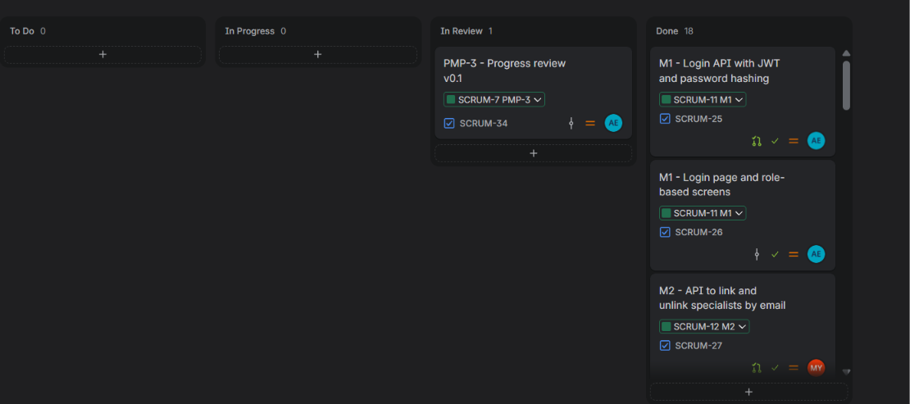

# Project Management Plan (PMP)

> The purpose of this PMP is to practice planning and tracking work in Jira. Keep it short: most of the content is a summary of what you set up in Jira.
> Keep this file at `docs/PMP.md`. Each section is one Jira epic (PMP-1 … PMP-6); mark the epic Done when the section is complete.
> Save screenshots in `docs/img/`.

| Section | Content | Required by |
|---|---|---|
| PMP-1 | Project, Jira setup, team and roles | Week 6 |
| PMP-2 | Work packages (epics) and sprint plan | Week 6 |
| PMP-3 | Progress review: mid-term (v0.1) | Mid-term evaluation (Week 8 / 9) |
| PMP-4 | Progress review: v0.2 | Week 10 |
| PMP-5 | Progress review: final (v1.0) | Final evaluation |
| PMP-6 | Retrospective | Final evaluation |

---

## PMP-1. Project and Team

### Project and Jira Setup

**Project in one sentence:** An AI-assisted web platform that brings parents, specialists and children together around a shared schedule, task list and record of observations, with role-based AI summaries that support human decisions.
**Jira project key:**  SCRUM
**Jira board link:**  https://g9synora.atlassian.net/jira/software/projects/SCRUM/boards/1

### Team and Roles

| Name | Jira / GitHub username | Role |
|---|---|---|
| Ali Ertekin | AliErtekin | developer |
| Muhammed Eren Yanık | yanikeren | developer |
| Bora Yaman | BoraY400 | developer, project manager |

---

## PMP-2. Plan

### Work Packages (Epics)

> One row per Jira epic. Number of tasks = how many tasks you created under that epic.

| Epic | Owner | Number of tasks | Planned sprint(s) |
|---|---|---|---|
| M1 | Ali Ertekin | 8 | Sprint 1,2,4 |
| M2 | Muhammed Eren Yanık | 3 | Sprint 2 |
| M3 | Ali Ertekin | 2 | Sprint 2 |
| M4 | Ali Ertekin | 2 | Sprint 2 |
| M5 | Ali Ertekin | 2 | Sprint 3 |
| M6 | Ali Ertekin | 2 | Sprint 3 |
| M7 | Ali Ertekin | 2 | Sprint 3 |
| M8 | Ali Ertekin | 3 | Sprint 3,4|
| DESIGN | Ali Ertekin | 3 | Sprint 2 |

### Sprint Plan

> One row per Jira sprint. Align sprints with the weekly schedule.

| Sprint | Weeks | Sprint goal | Ends with |
|---|---|---|---|
| Sprint 1 | 5 | Walking skeleton and PMP section 2 | Walking skeleton (v0.0), Week 6 |
| Sprint 2 | 6-9 | M1-M4: login, specialist linking, schedule, tasks | Release v0.1, mid-term (Week 9) |
| Sprint 3 | 10 | M5-M8: entries, documents, statistics, AI summary | Release v0.2, Week 10 |
| Sprint 4 | 11-12 | Bug fixing, final polish, retrospective | Release v1.0, final |

---

## PMP-3. Progress Review: Mid-term (v0.1)

**Jira board screenshot:** 

*Status at release v0.1 (Week 8, 2026-11-22).*

| Epic | Planned for this point | Status (Done / In progress / Not started) |
|---|---|---|
| PMP-1 | Project and Jira setup, team and roles | Done |
| PMP-2 | Work packages and sprint plan | Done |
| DESIGN | SRS and SDD first version (Week 6) | In progress (first version done; final version due in Week 10) |
| M1 | Walking skeleton (v0.0); login API, login page and role-based screens; first end-to-end test in CI | In progress (v0.1 scope done: 7 of 8 tasks; final README and v1.0 release planned for Sprint 4) |
| M2 | Link and unlink specialists, linked specialists screen, access check for unlinked specialists | Done |
| M3 | Schedule events API and weekly schedule view | Done |
| M4 | Tasks API and task screens for parent, specialist and child | Done |

**Changes to the plan (if any):**

- The Section 2 mid-term evaluation is in Week 9, so Sprint 2 was extended to Weeks 6–9.
- A task for the first end-to-end test and the v0.1 release (SCRUM-59) was added under M1, which now has 8 tasks.
- The DESIGN epic was added for the requirements and design documents. The AI provider for M8 is the Gemini API, with a mock mode for tests and CI.
- The M2 epic is owned by Muhammed Eren Yanık.
- The SENG 440 test team was cancelled by the instructor; weekly team meetings are recorded in `docs/meetings/` instead.

---

## PMP-4. Progress Review: v0.2

**Jira board screenshot:** 

*Status in Week 8, before Sprint 3. Release v0.2 (M1–M8) is due in Week 10.*

| Epic | Planned for this point | Status (Done / In progress / Not started) |
|---|---|---|
| M1–M4 | Release v0.1 | Done (v0.1 released; see PMP-3) |
| M5 | Specialist entries API with edited mark, entries screen | Not started (Sprint 3) |
| M6 | Document upload and download API, documents screen | Not started (Sprint 3) |
| M7 | Weekly statistics API, statistics screen | Not started (Sprint 3) |
| M8 | AI summary module with mock mode, summary screen with source links | Not started (Sprint 3) |
| DESIGN | Final SRS and SDD | Not started (Week 10) |

**Changes to the plan (if any):**

- Sprint 3 covers Week 10 only, so M5–M8, end-to-end tests for the three critical flows and the final SRS and SDD must be finished in one sprint.

---

## PMP-5. Progress Review: Final (v1.0)

**Jira board screenshot:**  

| Epic | Planned for this point | Status (Done / In progress / Not started) |
|---|---|---|
| | | |
| | | |

**Changes to the plan (if any):**

---

## PMP-6. Retrospective

- What worked well in using Jira:
- What we would do differently:
