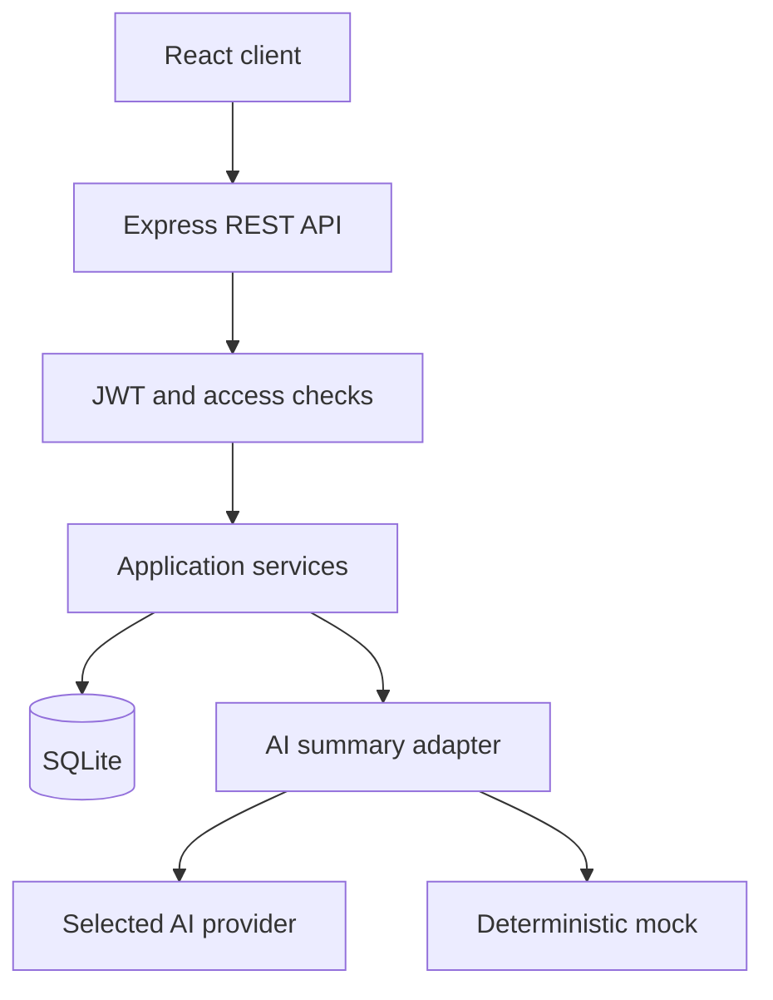
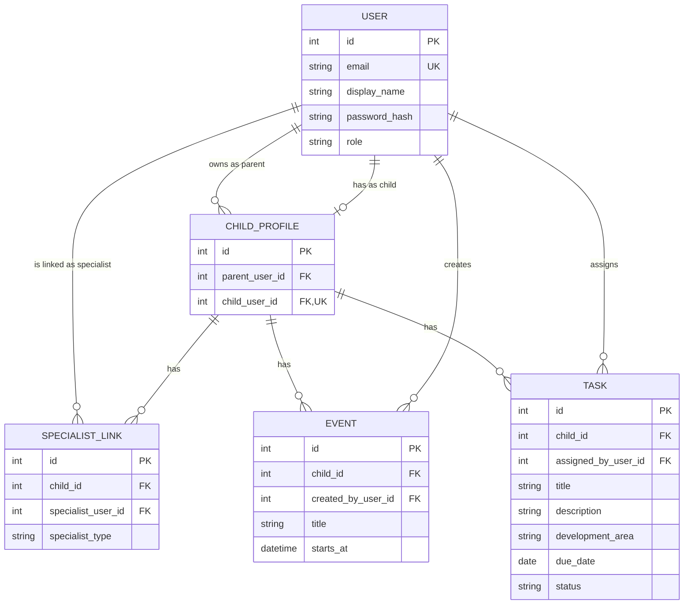
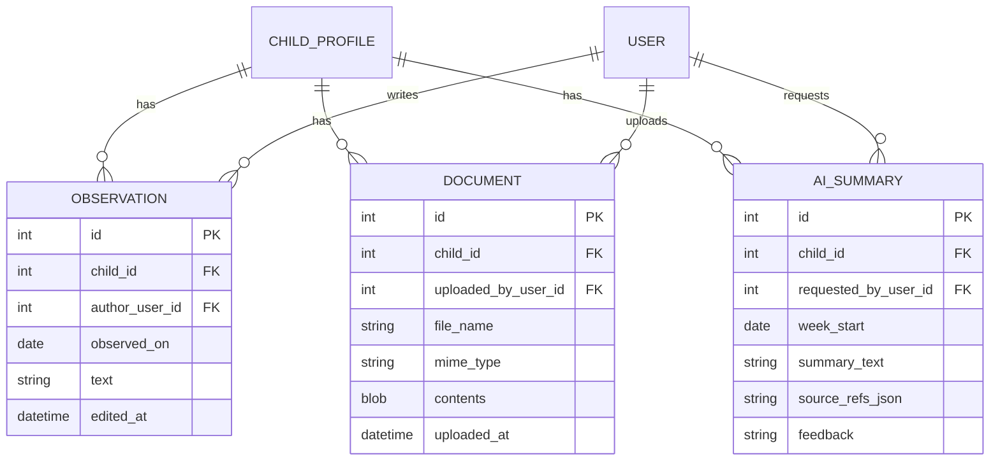
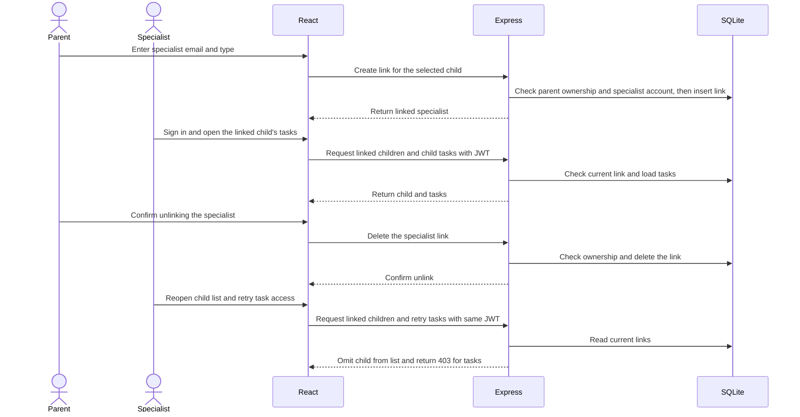
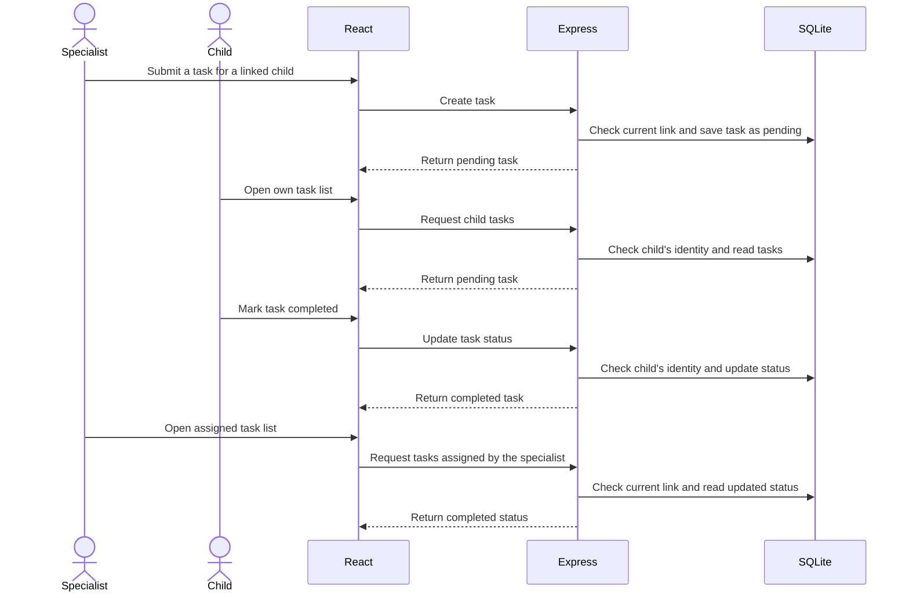
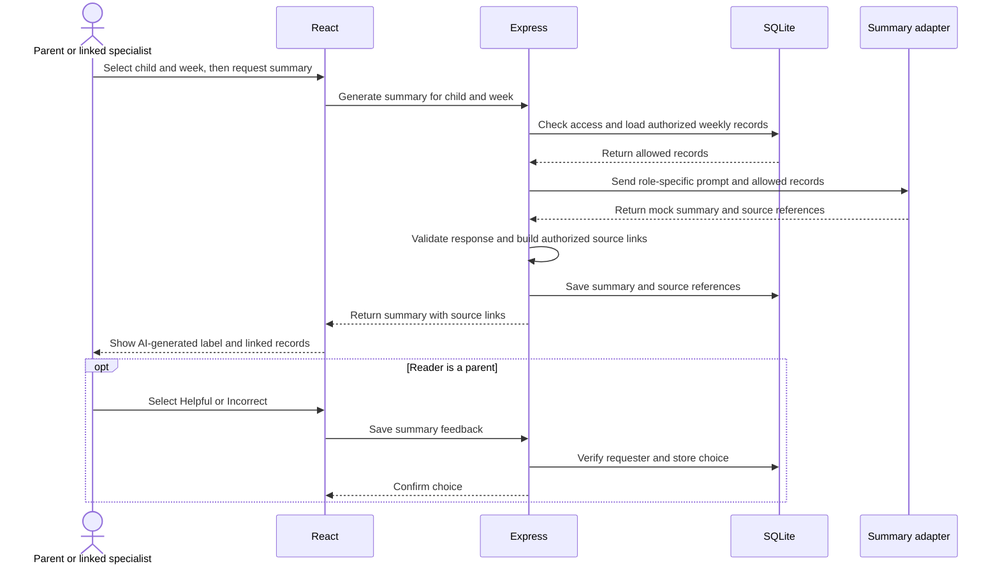

# Software Design Document (SDD)

**Team name:** SYNORA\
**Version:** ☒ First version (Week 6) ☐ Final (Week 10)\
**Last updated:** 2026-11-08

---

## 1. Architecture Overview

The `v0.0` skeleton connects the React client in `frontend/` to `GET /api/health` in `backend/src/app.js`, which checks SQLite using the connection from `backend/src/db.js`. For v0.1 and v0.2, Express will check identity and permissions before application services read or write SQLite data. The weekly summary service will use a backend adapter for the selected AI provider or a deterministic mock.

### Technology Stack

| Layer | Technology |
|---|---|
| Frontend | React with Vite |
| Backend | Node.js and Express, REST API, JWT authentication |
| Database | SQLite through `better-sqlite3`, with a planned synthetic data seed script |
| AI | Backend adapter for the team's Week 3 provider choice (Gemini API or GitHub Models) and a deterministic mock |
| Testing | Jest and Supertest for backend and API tests, Vitest for frontend tests, Playwright for end-to-end tests |
| CI | GitHub Actions with AI mock mode enabled |

---

## 2. Module Design

The component names and interfaces describe the planned design for releases v0.1 and v0.2.

| Module | Main components | Implements requirements |
|---|---|---|
| M1 – Login and roles | `LoginPage`, `AuthService`, `requireSession` and `ChildAccessPolicy` | FR-M1-01, FR-M1-02, FR-M1-03, FR-M1-04 |
| M2 – Linking specialists | `LinkedSpecialistsPage`, `ChildPicker` and `SpecialistLinkService` | FR-M2-01, FR-M2-02, FR-M2-03, FR-M2-04, FR-M2-05, FR-M2-06 |
| M3 – Weekly schedule | `WeeklyCalendar` and `EventService` | FR-M3-01, FR-M3-02, FR-M3-03 |
| M4 – Tasks | `TaskForm`, `AssignedTaskList`, `ChildTaskList` and `TaskService` | FR-M4-01, FR-M4-02, FR-M4-03, FR-M4-04 |
| M5 – Specialist entries | `ObservationList`, `ObservationForm` and `ObservationService` | FR-M5-01, FR-M5-02, FR-M5-03 |
| M6 – Documents | `DocumentsPage` and `DocumentService` | FR-M6-01, FR-M6-02, FR-M6-03, FR-M6-04 |
| M7 – Weekly statistics | `WeeklyProgressPanel` and `WeeklyStatsService` | FR-M7-01, FR-M7-02, FR-M7-03 |
| M8 – Role-based AI summary | `WeeklySummaryPanel`, `SummaryService`, role-specific prompts and the provider or mock adapter | FR-M8-01, FR-M8-02, FR-M8-03, FR-M8-04, FR-M8-05, FR-M8-06, FR-M8-07 |

`SummaryService` selects the prompt using the authenticated role. The parent prompt uses plain language, and the specialist prompt groups records by development area where applicable. Both ask for a summary grounded in the supplied records and prohibit diagnoses, treatment advice and decisions. The service supplies authorized events, tasks and dated observations from the selected week. It checks the response format, source IDs and advisory wording before returning the summary and links to the allowed records. The summary panel shows an error if the provider fails or the response fails validation. The provider key is read on the backend.

---

## 3. Data Model

### Accounts, schedule and tasks

### Observations, documents and summaries

- `SPECIALIST_LINK` has a unique `(child_id, specialist_user_id)` pair. Unlinking deletes that relationship and preserves existing tasks, events, observations and documents.
- Task status is `pending` or `completed`, displayed as Pending or Done. A new observation has no `edited_at` value. Updating it sets `edited_at`, which controls the Edited label.
- A selected week starts on Monday in the app's local time and ends before the following Monday. Events are selected by `starts_at`, tasks by `due_date` and observations by `observed_on`. The weekly completion percentage is the share of matching tasks marked done, rounded to the nearest whole percent. If the week has zero matching tasks, the panel shows an empty state.
- Documents store file contents and metadata together. The list query selects metadata. Summary source references identify a record type and ID. Feedback is empty until the requesting parent selects `helpful` or `incorrect`.

---

## 4. API / Interfaces

`AuthService` verifies the submitted password against the account's salted hash. After login, the client sends `Authorization: Bearer <token>`. The API verifies the JWT signature and expiry, then checks whether the account role can perform the requested action. On child-scoped routes it checks ownership, the current specialist link or the child's own account. It also checks that the requested record belongs to that child. Authentication failure returns `401`, denied access returns `403` and invalid input returns `400` unless a more specific error applies.

| Method | Endpoint | Description | Module |
|---|---|---|---|
| POST | `/api/auth/login` | Accepts email and password. Returns a JWT and account role, plus the child profile ID for a child account. | M1 |
| GET | `/api/children` | Lists the child profiles owned by the signed-in parent or currently linked to the signed-in specialist. | M2 |
| GET | `/api/children/{childId}/specialists` | Lists linked specialists for the parent of the selected child. | M2 |
| POST | `/api/children/{childId}/specialists` | The parent submits `email` and `specialistType`. Returns an error for an unregistered or non-specialist email. | M2 |
| DELETE | `/api/children/{childId}/specialists/{linkId}` | Removes the specified link after the parent's confirmation in the client. | M2 |
| GET | `/api/children/{childId}/events?weekStart=YYYY-MM-DD` | Lists events for the selected week for the parent, linked specialists and child. | M3 |
| POST | `/api/children/{childId}/events` | A parent or linked specialist submits `title` and `startsAt`. The start time includes a date and offset. | M3 |
| GET | `/api/children/{childId}/tasks` | Lists tasks and status for authorized users. `assignedBy=me` filters the assigner's view. | M4 |
| POST | `/api/children/{childId}/tasks` | A parent or linked specialist submits `title`, `description`, `developmentArea` and `dueDate`. The initial status is `pending`. | M4 |
| PATCH | `/api/children/{childId}/tasks/{taskId}/status` | The child sets their own task's status to `completed`. Repeating completion returns the completed status. | M4 |
| GET | `/api/children/{childId}/observations` | Lists dated observations for the parent and linked specialists. | M5 |
| POST | `/api/children/{childId}/observations` | A linked specialist submits `observedOn` and `text` to add an observation. | M5 |
| PATCH | `/api/children/{childId}/observations/{observationId}` | The linked author updates the date or text. The response includes the edit timestamp. | M5 |
| GET | `/api/children/{childId}/documents` | Lists document metadata for the parent and linked specialists. | M6 |
| POST | `/api/children/{childId}/documents` | Accepts a multipart `file` from the parent or a linked specialist and validates its type against the file bytes. | M6 |
| GET | `/api/children/{childId}/documents/{documentId}/content` | Returns the file to the parent or a linked specialist. `download=true` returns it as an attachment. | M6 |
| GET | `/api/children/{childId}/stats?weekStart=YYYY-MM-DD` | Returns total and per-area task counts and percentages for the parent and linked specialists. | M7 |
| POST | `/api/children/{childId}/summaries` | Accepts `weekStart` from the parent or linked specialist. Returns the summary ID, text and authorized source links when a summary is generated. | M8 |
| PUT | `/api/children/{childId}/summaries/{summaryId}/feedback` | The parent who requested the summary saves `helpful` or `incorrect`. | M8 |

---

## 5. Critical Flows

### Flow 1. Parent links and unlinks a specialist

### Flow 2. Task assignment and completion

### Flow 3. Role-based AI summary

---

## 6. User Interface

| Screen | Image | Module |
|---|---|---|
| Sign-in | [Sign-in sketch](img/sign-in.svg) | M1 |
| Parent weekly dashboard | [Parent dashboard sketch](img/parent-dashboard.svg) | M3, M4, M5, M7, M8 |
| Parent specialist links | [Specialist links sketch](img/specialist-links.svg) | M2 |
| Specialist child workspace | [Specialist workspace sketch](img/specialist-workspace.svg) | M2, M3, M5, M7, M8 |
| Task assignment and tracking | [Task assignment sketch](img/task-assignment.svg) | M4 |
| Child tasks and schedule | [Child workspace sketch](img/child-workspace.svg) | M3, M4 |
| Documents | [Documents sketch](img/documents.svg) | M6 |

---

## 7. Change Log

| Date | Change | By |
|---|---|---|
| 2026-11-08 | First version | SYNORA team |
