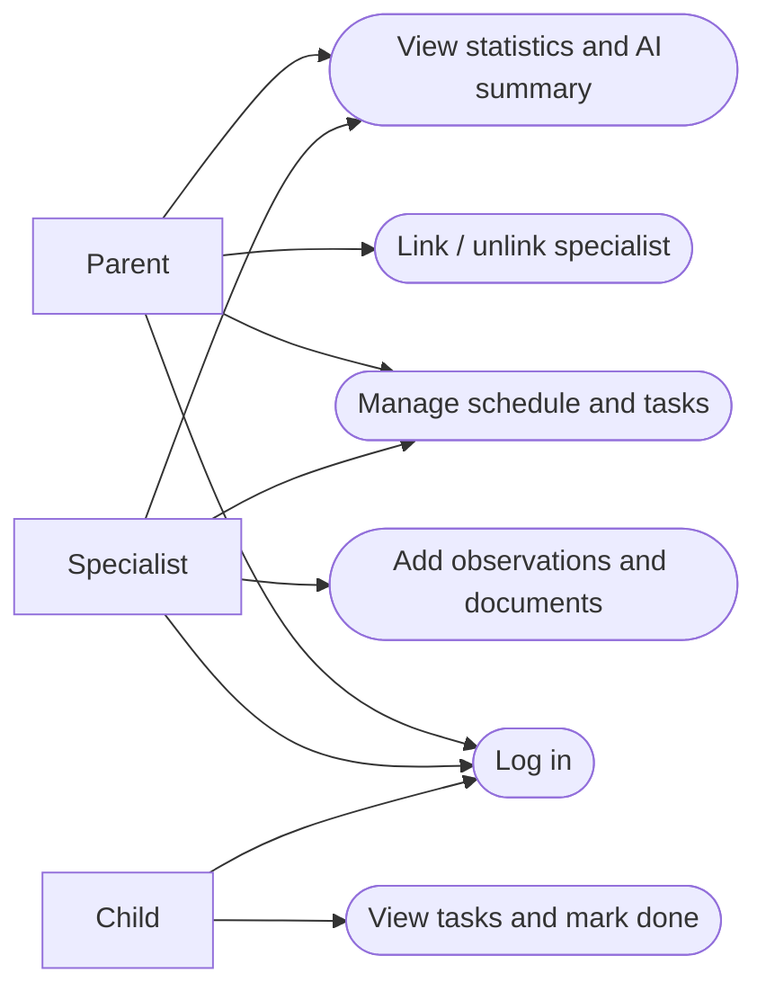

# Software Requirements Specification (SRS)

**Team name:** SYNORA  
**Version:** ☒ First version (Week 6) ☐ Final (Week 10)  
**Last updated:**  2026-10-25

---

## 1. Introduction

**Purpose of the system** (2–3 sentences):

The system is a web-based decision support platform that brings parents, specialists and children together around one shared schedule, task list and record of observations. An AI component summarizes the records for each reader according to their role. The AI supports decisions; it never makes them, and every suggestion is shown with the records it is based on.

**Users of the system:**

| User type | Description |
|---|---|
| Parent | Owns the child's data, sees all records, links and unlinks specialists. |
| Specialist | Teacher, psychologist, doctor, special education teacher or coach. Works only with the children they are linked to. |
| Child | Sees only their own tasks and schedule and marks tasks as done. |

---

## 2. Functional Requirements

### M1 – Login and roles

| ID | Requirement | Priority |
|---|---|---|
| FR-M1-01 | The system shall let a registered user log in with email and password. | Must |
| FR-M1-02 | The system shall determine the user's role (parent, specialist, child) from the account; the user does not choose it. | Must |
| FR-M1-03 | The system shall show each role only its own screens. | Must |
| FR-M1-04 | The system shall reject API requests without a valid JWT. | Must |

### M2 – Linking specialists

| ID | Requirement | Priority |
|---|---|---|
| FR-M2-01 | The system shall let a parent link a registered specialist to the child by email. | Must |
| FR-M2-02 | The system shall show an error when the email does not belong to a registered specialist. | Must |
| FR-M2-03 | The system shall let a parent unlink a specialist after a confirmation. | Must |
| FR-M2-04 | The system shall list the specialists linked to the child. | Must |
| FR-M2-05 | The API shall return an error for every request about the child from a specialist who is not linked. | Must |

### M3 – Weekly schedule

| ID | Requirement | Priority |
|---|---|---|
| FR-M3-01 | The system shall let a parent and linked specialists add an event with title, date and time. | Must |
| FR-M3-02 | The system shall list events in a weekly view. | Must |
| FR-M3-03 | The system shall let the child see upcoming events. | Must |

### M4 – Tasks

| ID | Requirement | Priority |
|---|---|---|
| FR-M4-01 | The system shall let a parent and linked specialists assign a task with title, description, development area and due date. | Must |
| FR-M4-02 | The system shall let the child mark a task as done. | Must |
| FR-M4-03 | The system shall show the assigner the status of the tasks they assigned. | Must |
| FR-M4-04 | The system shall show a child only their own tasks. | Must |

### M5 – Specialist entries

| ID | Requirement | Priority |
|---|---|---|
| FR-M5-01 | The system shall let a linked specialist add a dated observation about the child. | Must |
| FR-M5-02 | The system shall mark an edited entry as "edited". | Must |
| FR-M5-03 | The system shall hide specialist entries from the child. | Must |

### M6 – Documents

| ID | Requirement | Priority |
|---|---|---|
| FR-M6-01 | The system shall let a parent and linked specialists upload PDF or image files. | Must |
| FR-M6-02 | The system shall reject other file types with an error. | Must |
| FR-M6-03 | The system shall list documents with name, type, uploader and date, and allow viewing and downloading. | Must |
| FR-M6-04 | The system shall hide documents from the child. | Must |

### M7 – Weekly statistics

| ID | Requirement | Priority |
|---|---|---|
| FR-M7-01 | The system shall show the task completion rate for a selected week in total. | Must |
| FR-M7-02 | The system shall show the task completion rate for the selected week by development area. | Must |
| FR-M7-03 | The system shall show an empty state for a week without tasks. | Should |

### M8 – Role-based AI summary

| ID | Requirement | Priority |
|---|---|---|
| FR-M8-01 | The system shall generate a summary of the week's records for a parent using a parent-specific prompt. | Must |
| FR-M8-02 | The system shall generate a summary for a specialist using a specialist-specific prompt. | Must |
| FR-M8-03 | The system shall label every summary "AI-generated" and link it to its source records. | Must |
| FR-M8-04 | The system shall send the AI only data the reader is allowed to see. | Must |
| FR-M8-05 | The system shall not let the AI make decisions or suggest a diagnosis or treatment. | Must |
| FR-M8-06 | The system shall provide a mock AI mode for tests and CI. | Must |

---

## 3. Non-Functional Requirements

| ID | Category | Requirement |
|---|---|---|
| NFR-01 | Security | Passwords are stored hashed and access control is enforced in the API, not only in the interface. |
| NFR-02 | Privacy | Only synthetic data created by a seed script is used; no real personal data. |
| NFR-03 | Usability | Each role sees only the screens and actions it needs. |
| NFR-04 | Testability | Branch coverage is at least 40% for v0.2 and 60% for v1.0. |
| NFR-05 | Portability | The application runs locally by following the README. |

---

## 4. Critical Flows and Acceptance Criteria

| Flow | Related requirements | Acceptance criteria |
|---|---|---|
| Flow 1: Parent links and unlinks a specialist | FR-M1-01, FR-M2-01, FR-M2-03, FR-M2-05 | **Given** a logged-in parent and a registered specialist **When** the parent links the specialist and later unlinks them **Then** the specialist can access the child's data only while linked, and every API request after unlinking returns an error. |
| Flow 2: Task assignment and completion | FR-M4-01, FR-M4-02, FR-M4-03 | **Given** a linked specialist and a child **When** the specialist assigns a task and the child marks it done **Then** the specialist sees the status "done" for that task. |
| Flow 3: Role-based AI summary | FR-M5-01, FR-M8-01, FR-M8-03, FR-M8-04 | **Given** a week with records for a child **When** a parent requests the AI summary **Then** a summary labelled "AI-generated" is shown with links to its source records, and it uses only data the parent may see. |

---

## 5. Use Case Diagram (optional)

---

## 6. Change Log

| Date | Change | By |
|---|---|---|
| 2026-10-25 | First version | SYNORA team |
